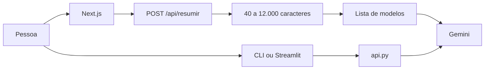

# Resumidor IA

[](https://nextjs.org/)
[](https://www.typescriptlang.org/)
[](https://react.dev/)
[](https://ai.google.dev/)
[](https://tailwindcss.com/)
[](https://streamlit.io/)

Resumo de artigo, relatório ou nota. A pessoa cola o texto, escolhe parágrafos, tópicos ou formato executivo, e o idioma. O sistema devolve só o resumo, no tamanho combinado, com a conta de quantas palavras saíram.

## O problema

Pedir "resume isso" num chat solto devolve preâmbulo, opinião e detalhe que o texto não tinha. "Até três parágrafos" vira quatro. "Em tópicos" vira um bloco com travessões. O nome próprio some e o número muda de uma casa.

O Resumidor fecha o contrato antes do modelo. O tamanho (40 a 12.000 caracteres) é checado na página e de novo em `POST /api/resumir`. O formato entra como instrução fechada, não como pedido livre. A instrução de sistema manda preservar nome e cifra, proíbe fato inventado e proíbe título, preâmbulo ou fechamento. O que volta para a tela é o corpo do resumo.

## Arquitetura



| Módulo | Função |
| --- | --- |
| `resumidor-web/src/app/page.tsx` | Texto, formato, idioma, envio e cancelamento |
| `resumidor-web/src/app/api/resumir/route.ts` | Validação, prompt e chamada |
| `resumidor-web/src/lib/gemini.ts` | Modelos com `generateContent`, cache de 5 min |
| `resumidor-web/src/lib/i18n.ts` | Interface em português e inglês |
| `resumidor-web/src/lib/text.ts` | Palavras de origem, palavras do resumo, corte |
| `resumidor-web/src/lib/types.ts` | `paragrafos`, `bullet`, `executivo` e os limites |
| `resumidor/api.py` | A mesma chamada, modelo fixo `gemini-1.5-flash` |
| `resumidor/app.py` | Streamlit com os três formatos |
| `resumidor/resumir.py` | CLI, sempre em parágrafos |

A interface web é o caminho completo. O Python repete a chamada ao Gemini para quem prefere terminal ou Streamlit.

## O contrato do resumo

Temperatura 0,3 e no máximo 1024 tokens de saída, nos dois lados. O idioma da resposta segue o idioma da tela (`pt` ou `en`), gravado em `localStorage` na chave `resumidor-lang`.

| Formato | Instrução |
| --- | --- |
| `paragrafos` | Até 3 parágrafos curtos, tom editorial |
| `bullet` | No máximo 5 linhas começando com •, uma ideia por linha |
| `executivo` | 2 ou 3 frases, o que importa para decidir |

Na web, `GEMINI_MODEL` escolhe o modelo. Sem essa variável, `src/lib/gemini.ts` consulta `generativelanguage.googleapis.com/v1beta/models`, fica com os que aceitam `generateContent` e usa o primeiro da lista. A lista fica em memória por 5 minutos. `GET /api/modelos` devolve essa mesma lista. Em desenvolvimento, o erro cru da API aparece na resposta. Em produção, a rota devolve a mensagem genérica.

O Python não consulta a lista. `resumidor/api.py` chama `gemini-1.5-flash` direto e lê `GEMINI_API_KEY` do `.env` da pasta `resumidor` ou da raiz. O CLI não oferece formato: manda `paragrafos`. O Streamlit oferece os três.

O corte exibido no cartão é contagem de palavras, não uma nota do modelo. `compressionLabel` faz `round((1 - destino / origem) * 100)`. Se o resumo não ficou mais curto, o percentual sai da frase e ficam só as duas contagens.

## Como rodar

Interface web. Node.js 18+.

```powershell
cd resumidor-web
npm install
npm run dev
```

A página abre em `http://localhost:3000`.

CLI e Streamlit. Python 3.10+.

```powershell
cd resumidor
python -m venv .venv
.\.venv\Scripts\Activate.ps1
pip install -r requirements.txt
python resumir.py
```

No CLI, cole o texto e termine com duas linhas em branco. O Streamlit:

```powershell
streamlit run app.py
```

Copie `.env.example` para `.env` na raiz e preencha a chave. A web também aceita `resumidor-web/.env.local`. Sem `GEMINI_API_KEY` no ambiente, a rota Next carrega o `.env` da pasta pai.

| Variável | Efeito |
| --- | --- |
| `GEMINI_API_KEY` | Chave do [Google AI Studio](https://aistudio.google.com/apikey). Sem ela, a rota responde 500 |
| `GEMINI_MODEL` | Só na web. Nome do modelo. Sem ela, entra o primeiro da lista com `generateContent` |

## O que a demo mostra

- Colar um artigo, uma ata ou um relatório e gerar o resumo.
- Trocar entre parágrafos, tópicos e executivo.
- Português ou inglês, com o texto da interface e a língua do resumo juntos.
- Botão de exemplo, limpar, `Ctrl + Enter` e cancelar a geração no meio.
- Cartão com o resumo, cópia para a área de transferência e "N palavras → N palavras · N% mais curto".

## Produção

No [Vercel](https://vercel.com), a pasta raiz do projeto é `resumidor-web`. A variável de ambiente é `GEMINI_API_KEY`. O framework é detectado como Next.js. Pela CLI, dentro de `resumidor-web`:

```powershell
npm i -g vercel
vercel
```

O CLI e o Streamlit ficam na máquina local. Eles não entram nesse deploy.
